# Linux Hardening Lab

I built this lab to get hands-on experience with Linux security and understand how different controls work in practice. I wanted to go beyond installing tools and following commands by testing what they actually allow or block, investigating the logs, and learning how to fix problems without disabling the protection.

I set up a Rocky Linux server and used Kali Linux as the test machine. I started by checking which services were running and disabling the ones the server did not need. I then tested firewall rules, investigated a SELinux access denial, and configured Fail2Ban to temporarily block repeated failed SSH login attempts.

For each test, I checked the results in the terminal and relevant logs, then verified that normal access could be restored. This write-up explains
the changes I made, what happened during testing, and the limits of what I demonstrated.

## Overview

I worked through the lab one change at a time so I could understand what each change affected. Installing a tool or seeing a service marked as running was only the starting point. I also needed to check what happened when I tested it. For each part of the lab, I followed the same approach:

1. Check the current settings and confirm what was working.
2. Make a specific change.
3. Test it and record the result.
4. Check the relevant settings and logs to understand what happened.
5. Where the test deliberately blocked access, check that access could be restored.

The work covered disabling unnecessary services, allowing HTTP access from the Kali machine through a specific firewall rule, testing how SELinux file labels affect Apache's access to web content, and using Fail2Ban to temporarily restrict SSH access after repeated failed logins.

## Lab environment and scope

I used two virtual machines in VMware: a Rocky Linux server to configure and protect, and a Kali Linux machine to run the tests against it. All testing stayed within my own lab.

### Virtual machines

| Machine | Purpose | Interface | IP address during testing |
| --- | --- | --- | --- |
| Rocky Linux 9.8 (Blue Onyx) | Server running the services and security controls | `ens160` | `192.168.42.128/24` |
| Kali Linux | Test machine used to send HTTP requests and make SSH login attempts | `eth0` | `192.168.42.129/24` |

The Rocky server's hostname was `linux-hardening-01`.

### Services and security controls

| Component | What I used it for |
| --- | --- |
| Apache | Serve a simple web page and test files |
| firewalld | Control network access to the server |
| SELinux | Control Apache's access to files based on their security labels |
| Fail2Ban | Monitor failed SSH logins and temporarily restrict access from the source IP |

### Network setup

During the tests, both machines used the same VMware host-only network. This let Kali communicate with Rocky without placing the lab directly on the physical network. The host computer could also access this network, so it was not isolated from the host itself.

I temporarily switched Rocky to NAT when it needed internet access for package downloads, then returned it to host-only networking for testing.

The IP addresses above are the addresses recorded during the tests. I did not configure or document them as static addresses.

I kept Rocky's VMware console available throughout the tests. This gave me a way to manage the server even when Kali's SSH access was blocked.

### Project boundaries

This project focuses on service reduction, firewall rules, SELinux, and Fail2Ban. It does not cover SQL injection, cross-site scripting (XSS), or exploiting application vulnerabilities.

## 1. Establishing the baseline

Before changing anything, I checked how the Rocky server was configured. I wanted a clear starting point so I could compare the results after each change rather than guess what had changed.

I checked the operating system, hostname, current user, network addresses, SELinux mode, firewall settings, and listening ports:

```bash
cat /etc/rocky-release
hostnamectl
whoami
ip -br address
getenforce
sudo firewall-cmd --get-active-zones
sudo firewall-cmd --zone=public --list-all
sudo ss -tulnp
```

SELinux was enforcing, and the `ens160` interface was assigned to the `public` firewall zone. The firewall allowed the `cockpit`, `dhcpv6-client`, and `ssh` services.

The listening-port check showed:

- SSH listening on TCP port 22.
- Avahi using UDP port 5353.
- CUPS listening on the local loopback address on TCP port 631.

One important distinction was that a firewall allowance did not mean a service was running. For example, Cockpit was allowed through the firewall, but the socket check did not show a listener on TCP port 9090.

I also checked which addresses services were listening on. CUPS was listening locally, so I did not treat it as a printing service that I had demonstrated was accessible from Kali.

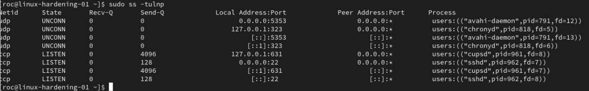
*Initial listening sockets before disabling unnecessary services.*

## 2. Reducing unnecessary services

The server did not need automatic service discovery or printing for its role in this lab. I disabled Avahi and CUPS to remove functionality I was not using.

I included their socket and path units as well as the main services:

```bash
sudo systemctl disable --now avahi-daemon.socket avahi-daemon.service
sudo systemctl disable --now cups.socket cups.path cups.service
```

I then rebooted the server and checked whether the services were still inactive:

```bash
systemctl is-active avahi-daemon.service avahi-daemon.socket cups.service cups.socket cups.path
sudo ss -tulnp
```

All five units remained inactive. The Avahi UDP 5353 and CUPS TCP 631 sockets were no longer present, while SSH remained available.

This showed that the change survived a reboot. In the case of CUPS, I had removed an unnecessary local service rather than closed a remotely accessible printing service demonstrated by the lab.

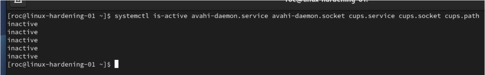
*All five targeted Avahi and CUPS units remained inactive after reboot* 

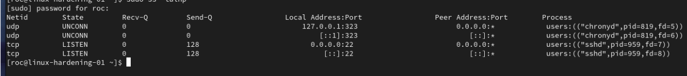
*Post-reboot socket check showing SSH still listening, with the Avahi and CUPS sockets absent.*

### Removing the unused Cockpit firewall allowance

I also removed the Cockpit allowance from both the running firewall configuration and the saved configuration:

```bash
sudo firewall-cmd --zone=public --remove-service=cockpit
sudo firewall-cmd --permanent --zone=public --remove-service=cockpit
sudo firewall-cmd --zone=public --list-services
sudo firewall-cmd --permanent --zone=public --list-services
```

Both service lists then showed:

```text
dhcpv6-client ssh
```

This removed the firewall allowance. It did not uninstall Cockpit or prove anything about its installation state.

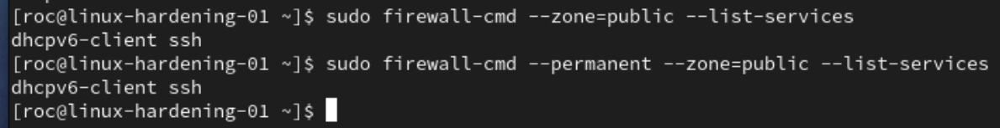
*Cockpit allowance absent from both runtime and permanent firewall service lists, with SSH retained.*

## 3. Testing source-specific HTTP access

I used Apache to serve a simple web page so I could test access from Kali.

The first HTTP request from Kali failed. Before changing the firewall, I checked that Apache was listening on port 80 and confirmed which firewall zone was active:

```bash
sudo ss -lntp 'sport = :80'
sudo firewall-cmd --get-active-zones
```

Rather than allow HTTP generally, I added a rule specifically for Kali’s recorded IP address:

```bash
sudo firewall-cmd --zone=public --add-rich-rule='rule family="ipv4" source address="192.168.42.129/32" service name="http" accept'
```

I then repeated the request from Kali:

```bash
curl --noproxy "*" --max-time 5 -i http://192.168.42.128/
```

This time, Apache returned `HTTP/1.1 200 OK` and the expected page.

The running firewall configuration showed the rule for Kali’s address, without a general HTTP service allowance or an explicit port allowance.

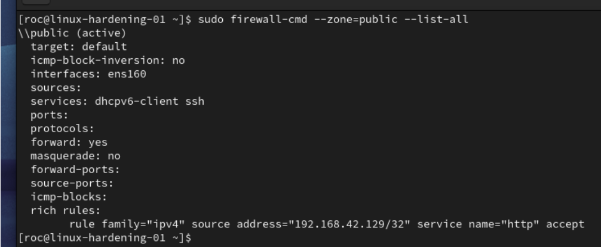
*Runtime public-zone configuration allowing HTTP from Kali’s address.*

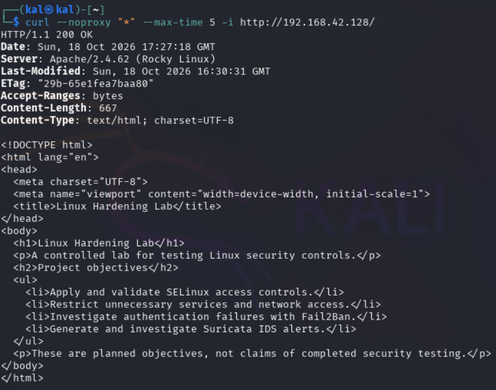
*Successful HTTP request from Kali, returning 200 OK and the expected lab page.*

This demonstrated that Kali could access the page with the rule in place. I did not test HTTP access from another, unapproved address, so that part of the restriction was not independently verified.

The recorded evidence also does not fully verify the rule’s saved configuration or its behaviour after a reload. I therefore describe this as a successful runtime test, not a completed persistence test.

The rule used Kali’s IP address, so it would also need reviewing if that address changed.

## 4. Testing SELinux and restoring access

I wanted to understand how SELinux could affect Apache’s access to a file even when the ordinary file permissions appeared correct.

I carried out two separate exercises. The first used a local request to `selinux-test.html` with an intentionally changed `samba_share_t` label. The main test below used Kali to request `selinux-probe.txt`, which I deliberately changed to `default_t`.

These were separate tests, not different stages of one experiment.

### Checking that the file was accessible

I created a harmless text file, set its permissions to `0644`, and applied the expected SELinux label:

```bash
printf '%s\n' 'SELinux controlled access test.' | sudo tee /var/www/html/selinux-probe.txt
sudo chmod 0644 /var/www/html/selinux-probe.txt
sudo restorecon -v /var/www/html/selinux-probe.txt
```

The file had the `httpd_sys_content_t` type, Apache was running in the `httpd_t` domain, and SELinux was enforcing.

A request from Kali returned `200 OK` and the test text. This gave me a working baseline before deliberately changing the label.

### Changing the label and investigating the failure

I changed the test file’s SELinux type:

```bash
sudo chcon -t default_t /var/www/html/selinux-probe.txt
```

The same request from Kali then returned `403 Forbidden`, even though the ordinary file permissions remained `0644`.

I did not treat the HTTP error alone as proof that SELinux caused it. I checked the file label, SELinux mode, and relevant audit records:

```bash
getenforce
ls -lZ /var/www/html/selinux-probe.txt
sudo ausearch -m AVC -c httpd -ts recent -i
```

The audit records linked Apache’s denied operation to the exact test file:

| Detail | Recorded result |
| --- | --- |
| Process | `httpd` |
| Process security domain | `httpd_t` |
| Target file | `/var/www/html/selinux-probe.txt` |
| File type | `default_t` |
| Denied permission | `getattr` |
| System call and result | `newfstatat`, `EACCES` |
| Enforcement indicator | `permissive=0` |

This connected the failed request to an enforced SELinux denial against the incorrectly labelled file.

The recorded denial was for `getattr`, an operation involving file information. I did not describe it as a recorded file-content read denial or count the two audit events as two separate attacks.

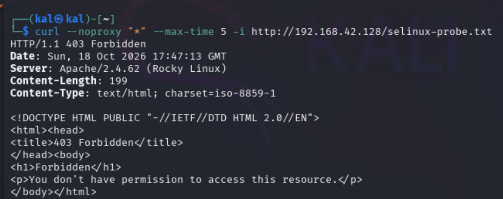
*Kali’s request to the deliberately mislabelled probe returned 403 Forbidden.*

### Restoring access without disabling SELinux

I restored the file’s expected label and checked the result:

```bash
sudo restorecon -v /var/www/html/selinux-probe.txt
ls -lZ /var/www/html/selinux-probe.txt
getenforce
```

The file type returned to `httpd_sys_content_t`. Kali could retrieve the original text again with a `200 OK` response, and SELinux remained enforcing.

The complete sequence was:

1. Confirm the file was accessible.
2. Change its SELinux label.
3. Observe the failed request.
4. Find the matching audit evidence.
5. Restore the correct label.
6. Confirm access worked again without disabling SELinux.

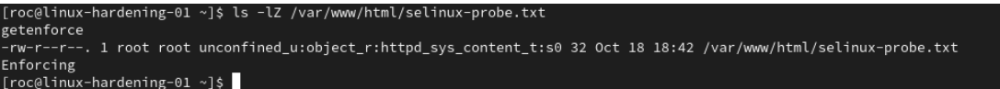
*Correct file label restored, with SELinux remaining enforcing.*

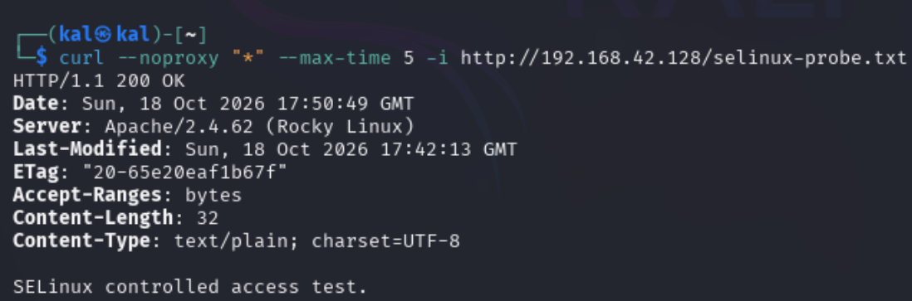
*Kali successfully retrieved the original probe content after the correct label was restored.*

## 5. Testing Fail2Ban SSH protection

For this part of the lab, I wanted to follow the whole sequence: a failed login being recorded, Fail2Ban detecting repeated failures, a firewall restriction being applied, and normal access returning after the ban expired.

### Checking the SSH settings

The recorded SSH settings showed:

- SSH using port 22.
- Password and public-key authentication enabled.
- Keyboard-interactive authentication disabled.
- `PermitRootLogin` reported as `without-password`.
- `MaxAuthTries` set to six attempts per connection.

The root-login setting prohibited root password login. It did not disable every form of root SSH access.

I also kept the SSH attempt limit separate from Fail2Ban’s settings. The former applied per connection; the Fail2Ban test tracked failures from a source address.

### Configuring the SSH jail

I installed Fail2Ban with support for the systemd journal and firewalld.

The following configuration summarises the recorded setup. It is reconstructed from the lab record rather than copied from a current configuration export:

```ini
[sshd]
enabled = true
backend = systemd
filter = sshd
port = 22
banaction = firewallcmd-rich-rules[zone=public]
maxretry = 5
findtime = 10m
bantime = 5m
ignoreip = 127.0.0.1/8 ::1
```

The settings told Fail2Ban to apply a temporary SSH restriction after five matching failures within ten minutes, with a configured ban time of five minutes.

Runtime checks confirmed:

```text
maxretry = 5
findtime = 600
bantime = 300
```

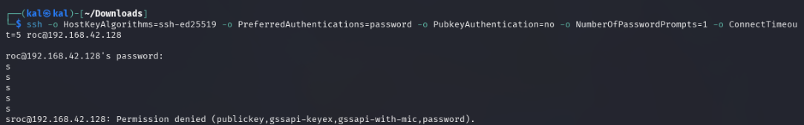
*First screenshot of the Fail2Ban runtime verification checks.*

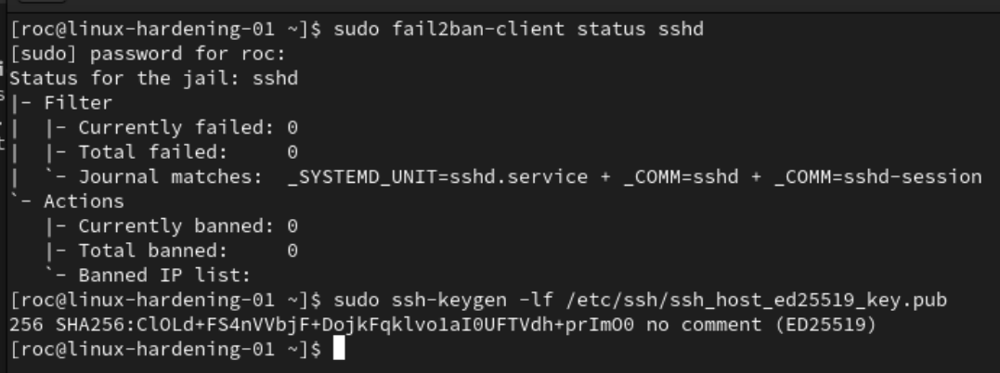
*Additional checks during Fail2Ban runtime verification.*

### Checking detection with one failed login

After checking the server’s host-key fingerprint and Fail2Ban’s starting counters, I made one deliberately incorrect password attempt from Kali:

```bash
ssh -o HostKeyAlgorithms=ssh-ed25519 \
    -o PreferredAuthentications=password \
    -o PubkeyAuthentication=no \
    -o NumberOfPasswordPrompts=1 \
    -o ConnectTimeout=5 roc@192.168.42.128
```

I then checked the SSH journal and Fail2Ban status on Rocky:

```bash
sudo journalctl -u sshd --since "5 minutes ago" --no-pager
sudo fail2ban-client status sshd
```

The SSH journal recorded a failed password for `roc` from Kali’s address, `192.168.42.129`. Fail2Ban showed one detected failure and no active ban.

A separate connection timeout occurred before authentication. I did not count that as another confirmed failed-password attempt.

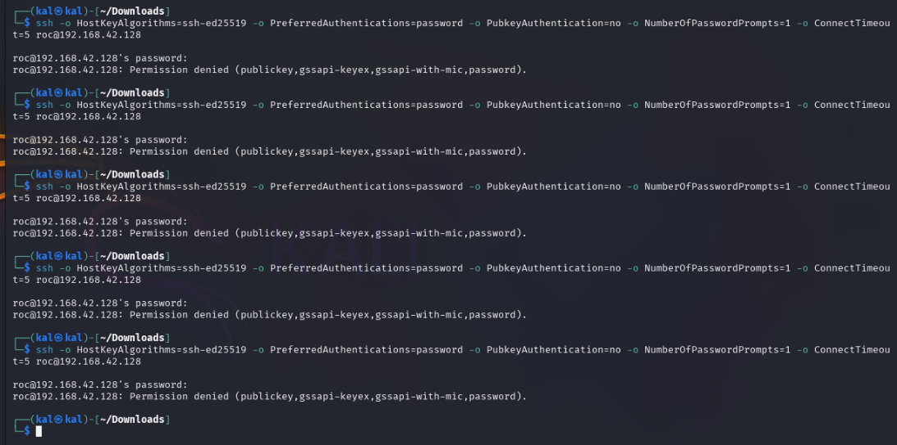
*First screenshot collected during the controlled SSH single-failure test.*

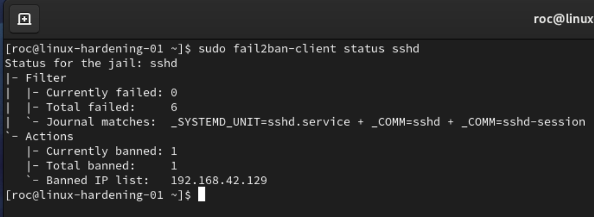
*Second screenshot collected during the controlled SSH single-failure test.*

### Checking that the ban was enforced

I made further manual failed-login attempts until Fail2Ban listed Kali’s address as banned.

The firewall then contained this SSH rejection rule:

```text
rule family="ipv4" source address="192.168.42.129" port port="22" protocol="tcp" reject type="icmp-port-unreachable"
```

A fresh SSH connection from Kali returned:

```text
ssh: connect to host 192.168.42.128 port 22: Connection refused
```

I checked these results together rather than rely on the connection error alone:

- Fail2Ban listed Kali as banned.
- The firewall contained a matching rule for Kali’s address and SSH port.
- A new SSH connection from Kali was refused.

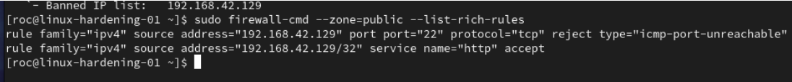
*First screenshot selected for the Fail2Ban enforcement section.*

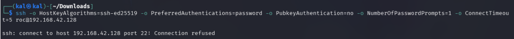
*Second screenshot selected for the Fail2Ban enforcement section.*

The restriction targeted SSH from Kali, not all traffic from that machine. The separate HTTP allowance remained configured, but I did not test HTTP access while the SSH ban was active.

The cumulative `Total failed` counter showed six. That did not change the configured threshold of five, and the available evidence did not establish the exact order in which every failure was counted.

### Checking automatic expiry and recovery

After the ban expired, I checked Fail2Ban and the firewall again.

There were no active bans, and the SSH rejection rule was no longer present. The unrelated HTTP allowance remained configured.

I then completed a legitimate SSH login from Kali. The recorded recovery did not involve a manual unban.

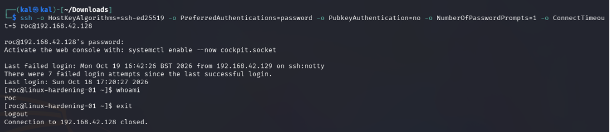
*First screenshot selected for the Fail2Ban expiry and recovery section.*

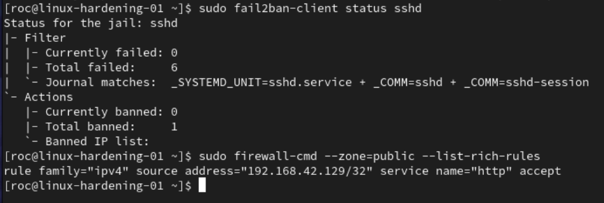
*Second screenshot selected for the Fail2Ban expiry and recovery section.*

This demonstrated automatic removal of the restriction and successful recovery.

The configured ban time was 300 seconds. I did not measure the exact elapsed time using timestamped Ban and Unban records, so I do not claim an independently measured five-minute duration.

## Results

| Area | What I verified |
| --- | --- |
| Unnecessary services | Avahi and CUPS units remained inactive after reboot, and their recorded sockets were absent. |
| Firewall cleanup | The Cockpit allowance was removed from both runtime and permanent service lists. |
| HTTP access | Kali could retrieve the Apache page with a source-specific runtime rule in place. |
| SELinux | An incorrect file label caused an audited denial; restoring the expected label restored access while SELinux stayed enforcing. |
| Fail2Ban detection | A controlled failed SSH login appeared in the journal and Fail2Ban’s counters. |
| Fail2Ban enforcement | Kali’s address was banned, a matching SSH firewall rule appeared, and a fresh connection was refused. |
| Fail2Ban recovery | The restriction expired automatically, its firewall rule disappeared, and a legitimate SSH login succeeded. |

## Limitations and follow-up

This was a learning lab, not a full security audit or proof that the server was ready for production.

The following checks remain incomplete or outside the project’s scope:

- HTTP restrictions: I did not test an unapproved source or fully verify the HTTP rule after saving and reloading the firewall.
- Fail2Ban timing and persistence: I did not measure the exact ban duration or complete a reboot-and-retest of enforcement.
- Apache configuration: The working record contains a `ServerName` warning, but no completed correction is documented.
- Final network state: Later Suricata preparation left Rocky reporting a NAT address. The earlier host-only test addresses should not be assumed to describe the current setup.
- Suricata closeout: Installation was recorded, but live monitoring was not verified. Its final running and boot-enablement states need checking separately.
- Wider security coverage: I did not comprehensively assess IPv6 rules, authentication attempts spread across multiple source addresses, or web-application vulnerabilities.

These limits separate what I completed from what still needs testing.

## What I learned

The most useful part of this lab was learning to check the outcome of a change rather than assume the command had achieved everything I intended.

- Start with a baseline. Checking services, ports, addresses, and firewall settings first made the later results easier to interpret.
- Check both configuration and behaviour. A firewall rule, running service, or ban entry was only part of the evidence.
- Separate working now from surviving a restart. A successful runtime test did not automatically demonstrate persistence.
- Investigate the cause of a failure. The SELinux exercise required matching the HTTP error to the file label and audit record.
- Fix the underlying problem. Restoring the file label recovered access without disabling SELinux.
- Test detection, enforcement, and recovery separately. Each Fail2Ban stage answered a different question.
- Keep another way to administer the server. VMware console access remained available during deliberate SSH restrictions.
- Keep conclusions within the evidence. Where a check was incomplete, I recorded the limitation rather than describe it as verified.

## Evidence and publication notes

This write-up brings together the lab’s working notes, recorded terminal output, and selected screenshots.

Screenshots will be checked for sensitive information before publication. They will be placed beside the test they support so the commands, results, and explanation can be read together.

The commands document what I did in this environment. They are not an automated setup script or a set of instructions to apply unchanged to another server.
